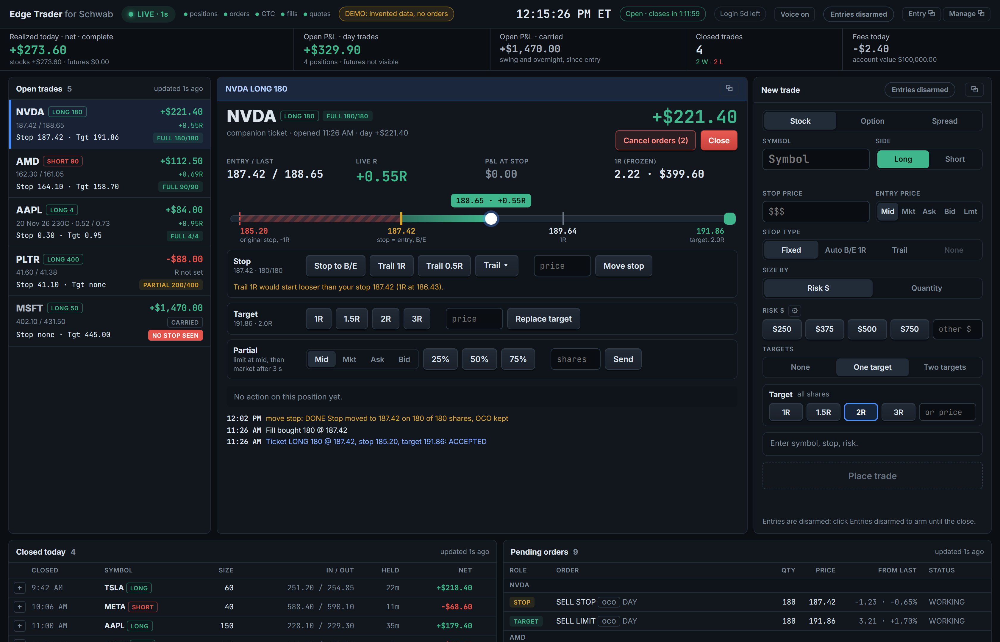
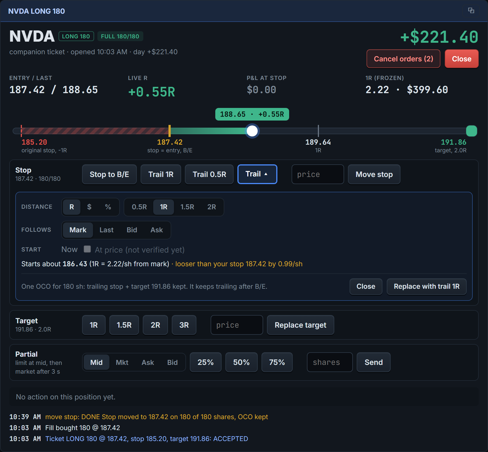
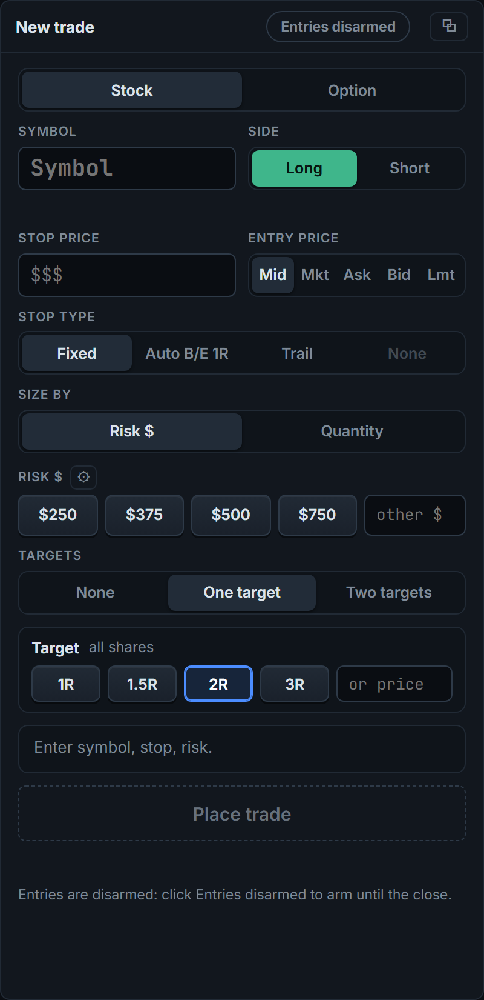
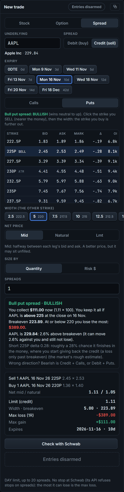
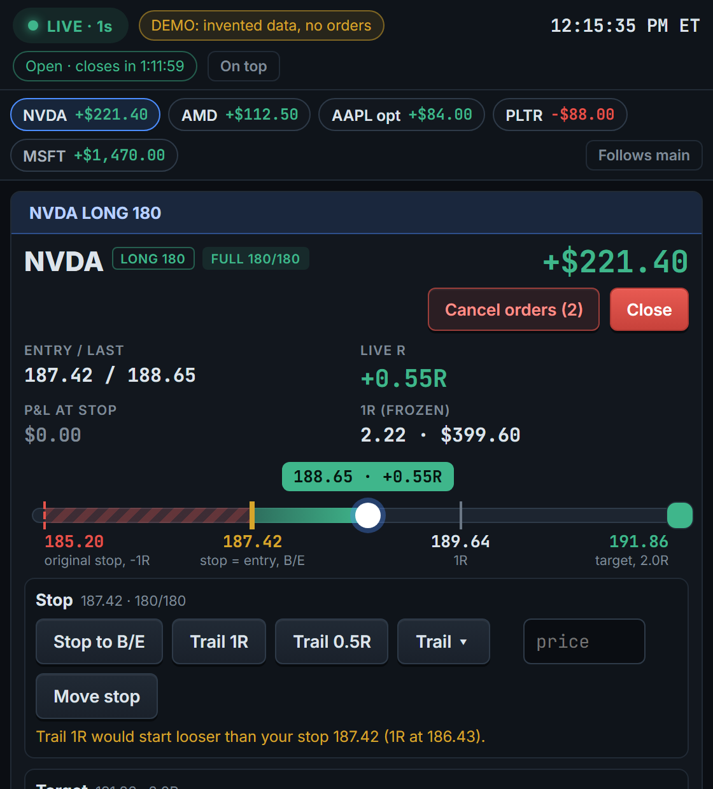

# Edge Trader for Schwab

[](https://github.com/simonro/edge-trader-for-schwab/actions/workflows/ci.yml)
[](https://github.com/simonro/edge-trader-for-schwab/releases/latest)
[](LICENSE)
[](https://youtu.be/41VQNmCN2r4)

A local day-trading dashboard and one-click order ticket for a Charles Schwab account, built on the
Schwab Trader API. It shows your open positions with live R, open and realized P&L and every working
order, and lets you enter a fully protected bracket (entry, stop and target, sized from the dollars you
want to risk) and manage it with one click: stop to break-even, move the stop, trail it, replace the
target, take partials, cancel or close. It runs on your own computer, next to thinkorswim or your charts.

- **Your data stays on your computer.** No account with us, no cloud, no telemetry. The app talks only to Schwab.
- **Every order is your click.** No signals, no auto-trading. Two exceptions, both opt-in per trade: pick "Auto B/E 1R" on the ticket and the app moves that trade's stop to break-even once, when price reaches +1R; tick "Send when hit" on a spread's stop and the app sends that spread's close once, when the stop is reached.
- **Protection first.** Entries go in as one Schwab bracket, so the stop and target live at Schwab even if the app or your PC is off. Leaving out the stop is possible only when you size by quantity, and the ticket asks you to confirm it every time.
- **Honest numbers.** P&L comes from your own fills, and anything incomplete is labeled as such, never shown as complete.
- **Free and MIT licensed.** No paid tier.

**[Quick start](#quick-start)** · **[Your Schwab app](#your-schwab-app)** · **[Releases](https://github.com/simonro/edge-trader-for-schwab/releases)** · **[Privacy](#privacy-and-your-data)**

**What this is not:** not financial advice, not a signal service, not affiliated with or endorsed by
Charles Schwab. Every screenshot below is invented demo data, not anyone's real account.



[](https://youtu.be/41VQNmCN2r4)

**[Watch the walkthrough first](https://youtu.be/41VQNmCN2r4)** on the Tape to Edge YouTube channel: a full tour on a live account, from sizing the shares from your risk and sending the bracket to partials that rebuild your stop and target, then the setup and the limits.

## Built on Schwabdev

Edge Trader connects to Schwab through **[Schwabdev](https://github.com/tylerebowers/Schwabdev)** by
**Tyler Bowers** (MIT licence), the Python client for the Schwab Trader API. Schwabdev handles the
Schwab sign-in (OAuth), the token refresh and the API calls. Thank you, Tyler. If Edge Trader is useful
to you, consider starring Schwabdev too.

## Privacy and your data

Edge Trader runs on your own computer and listens on `127.0.0.1` only (requests with any other host
name are refused). It needs no account and sends no telemetry.

### What stays local

- Your Schwab tokens (`~/.schwabdev/tokens.db`, managed by Schwabdev) and your app key and secret (`.env`).
- Everything the app records: positions, orders, fills, the action log and your settings, in `data/companion.db`.
  Your fills (without the account number) can be read at `/api/fills` by apps that reach Edge Trader's
  address, such as Trading Journal AI on the same server (see "Running on a home server").
- A record of every network call in `data/netlog/YYYY-MM-DD.jsonl` (UTC date, one JSON line each,
  `companion/netlog.py`). An `answer` line per HTTP answer (Schwab, Edge Scanner, GitHub): the path with
  account and order ids removed, the status, the time on the wire and the vendor's own clock. A `call`
  line per call as the app sees it: who asked (the poller, a ticket click, the status reads after a send,
  Auto B/E), what it waited on before it went out (the 429 pause, the poller's limiter, Schwabdev's lock
  and token check), the time on the wire, the body, the error class and, for quotes, how old Schwab's
  quote was when it arrived. An `inflight` line when a call is still open after 2, 5, 10, 30 and 60 s, a
  `skip` line for a read the 429 pause held back or a poll that gave way to busy order traffic (reason
  `light`, `after_burst`, `reserve`, `held` or `minute_full`, `companion/poll_budget.py`), `pause` lines for the
  pause's start and end, a `token` line when a call sees the access token renewed, and once a minute a `lag` line (how late a thread and the
  web server wake, CPU, memory, the token's time left, and the count, p95 and slowest time of each route
  the screens poll that minute).
  Each click on a ticket, position, spread or Opening plan button gets a `route` line with its duration and
  an id that its `call` lines carry too, so a click and its Schwab calls line up. A read the screens poll
  (the state every second, fills, the Opening plan) gets its own `route` line only when it takes 100 ms or
  more or does not answer 200. An order action that sends nothing, Opening plan Place, Cancel and Flip
  included, writes a `refusal` line with the message you saw, its digits replaced by `#`. Call and answer
  lines use the same fields as Edge Scanner's record. No tokens, keys, account numbers, request or answer
  bodies, order prices or sizes. Nothing in the app reads it back to decide anything. About 40 MB a day
  while the app runs (most of it the poller's account and order reads, all day), plus about 1 MB for each
  hour a position or working order is quoted and about 1.4 MB for each hour the Opening plan page reads
  Edge Scanner. The shadow log's open-tape reads add about 0.65 MB a day (two `call` and `answer` lines
  a second from 09:29 to 09:36 ET, about 790 bytes a read). Nothing deletes it yet.
  `GET /api/netlog/summary` shows, from memory, each vendor and endpoint's count, errors and p50/p95/max
  times for the last 5 minutes and since 09:25 ET, the calls in flight, the pause and the last lag line.
- Warnings and errors in `data/logs/edge-trader-YYYY-MM-DD.log` (UTC date). `data/companion.log` already
  keeps INFO and above in the same data folder, which a rebuild on a home server keeps. This file adds one
  file per day and the web server's own errors, which otherwise reach only the container's log, and a
  rebuild deletes that.

### What leaves your computer

- **Schwab** (`api.schwabapi.com`): the Trader API calls that read your account and send the orders you click.
- **GitHub** (`api.github.com`), once a day: a check for a newer Edge Trader release. It only shows a
  notice; it never downloads or installs anything. Turn it off with `EDGE_TRADER_NO_UPDATE_CHECK=1` in `.env`.
- **Google Fonts**: the page loads the Inter and JetBrains Mono fonts. Offline it falls back to system fonts.
- **Edge Scanner, only if you set `EDGE_SCANNER_URL`** (off by default): the Opening plan screen reads
  Edge Scanner's OV picks (`GET /api/v2/ov-picks`, at most every 2 seconds) and its clock
  (`GET /api/v2/clock`, for SPY RV20, at most once a minute) on your LAN, only while the screen is open,
  and on weekdays from 09:29 to 09:36 ET when the shadow log is on (`EDGE_TRADER_SHADOW=1`, below).
  The shadow log also reads Edge Scanner's open tape (`GET /api/v2/ov-picks/open-tape`, at most every
  0.25 seconds with a 0.5 second time limit, from 09:29 to 09:36 ET only; Edge Scanner answers from
  memory and asks Alpaca for nothing more).
  Each read carries `X-Edge-App: edge-trader` and the call's id in `X-Edge-Req`, so Edge Scanner's own
  record can name it. The armed plan (`EDGE_TRADER_PLAN_AUTO=1`, below) reads the same open tape through
  the same reader, so with the shadow log on as well it is still at most one read every 0.25 seconds:
  once when its Arm dialog opens and once at the Arm click, then, only while armed, from 09:31:00 ET to
  the end of the watch (at the latest 09:35:45 ET). Before each send it also checks the pick's row against the
  last OV picks answer that the Opening plan screen or the shadow log fetched. It never asks Edge Scanner's
  picks route itself.
- **Opening probe, only if you set `EDGE_TRADER_OPEN_PROBE=1`** (off by default, never in `--demo`):
  around the open it reads Schwab quotes and previews Break orders, and **sends no order**. Its own
  Schwab client allows only `quotes` and `preview_order`; every other call raises an error. Windows are ET,
  weekdays, from `companion/open_probe.json` (default 09:26:30 to 09:40:00). Every 5 seconds it asks one
  quote for the day's Opening plan symbols (ranks 1 to 4, at most 6) plus SPY. At 09:27:00, 09:27:30,
  09:28:00, 09:28:30, 09:29:30, 09:30:02, 09:31:02, 09:32:00, 09:33:00 and 09:35:00 it previews a long and a
  short Break order for one pick, the next in rank order each time, so ranks 1 to 4 are covered both sides
  before the open and again after it (SPY when there are no picks). Long: trigger = ask + the larger of
  5 cents and 0.2%, stop = trigger - 1% of the price. Short (`SELL_SHORT`): trigger = bid - the same step,
  stop = trigger + 1%. Each order is built at 1 share by the ticket's own builders (the Break entry stays
  capped at 1 share), then a copy with 100 shares in every leg (`preview_shares`) is previewed, so Schwab's
  numbers are readable. At most 2 previews per time and 24 per window. It writes `kind: "probe"` lines to
  `data/netlog/`: Schwab's quote and trade times and their age when the answer arrived, bid, ask, last, the
  wire time, and for a preview: the order's own side, type, quantity, trigger, limit and stop; the status
  word; the texts of Schwab's rejects, warns, alerts, accepts and reviews (rule name and message), so a
  hard-to-borrow or not-shortable answer is there word for word; on a refused preview the texts of its
  message and errors; `keys`, the dotted key names of Schwab's answer (names only, never a value; a key
  that looks like an account number or hash shows as `{id}`); the order value and the projected commission
  and fees with the path each was read from; and the requirement rates `bp_rate` and `af_rate` =
  (the account's buying power or available funds before, minus Schwab's projected value) / the order
  value, with the two fields each came from. The "before" value is the account read the app already makes
  every 5 seconds; older than 30 seconds gives no rate and says why. A pairing is taken only when its rate is
  from -0.05 to 5 (an opening order never adds buying power); otherwise the next balance is tried, and when
  none fits the line says "negative" or "above 5" for each, never the number. In every text it writes from
  Schwab, a number after a `$` and any number of 4 or more digits becomes `{n}`, so a "not enough buying
  power" text never carries a balance; "100%" or "12.5" stay. **No balance, equity or buying power in
  dollars is ever written**, and nothing else from the answer (it holds the account number). No retries:
  any 429, or the app's own 429 pause, stops it for the rest of the window. About 182 Schwab requests per
  default window (162 quote calls and 20 previews in 13.5 minutes), on the same Schwab app limit as
  everything else. With `EDGE_SCANNER_URL` set it reads the picks from Edge Scanner a minute before each
  window (09:25:30 ET by default). When that gives no picks it reads again every 15 seconds (one request to
  Edge Scanner on your LAN, never to Schwab) until the picks come or 09:29:00 ET, then starts the rotation at
  rank 1; no picks by then means SPY only, and a note says which (`companion/open_probe.py`). Picks that come
  inside the window are quoted at once; picks that come before it wait for the window start, so Schwab is
  never asked outside the window.

### API keys

Keys live in `.env` on your machine, which is never committed. Do not share or commit `.env`, the
`data` folder, the tokens file, or screenshots of your real account.

## What's inside

- **Dashboard:** open positions (day trades and carried positions apart) with open P&L, live R, stop
  and target, protection (FULL, PARTIAL, NO STOP SEEN) and P&L at the stop; working orders including
  brackets and GTC orders; closed trades and realized P&L from your fills; a health light (LIVE,
  STALE, DISCONNECTED) that disables every order button when data is not current. The account and
  order list are read every 5 s, marks every 3 s and fills every 10 s. While a ticket window has
  focus or after a click, marks come every 6 s instead of 3, so the account and order list keep
  their pace within the app's limit of 70 Schwab calls a minute (`MAX_PER_MIN`,
  `companion/poller.py`). With up to two clicks a minute marks and fills never show as old; with
  three clicks close together marks can be up to 15 s old for a moment and show as old (after 9 s).
  In heavier order traffic (30 or more order calls a minute) marks, fills and realized P&L can show
  as old until it eases (`companion/poll_budget.py`).
- **New trade:** symbol, side, stop, risk in dollars (four buttons you set yourself), entry at the mid,
  market, ask, bid or your own limit price (Lmt), one or two targets by R or by price, and a fixed stop, a trailing stop, or "Auto
  B/E 1R": a fixed stop that the app moves to break-even once when the mark reaches +1R of your fill
  (it checks every 3 seconds and only while the app is running; it never loosens a stop). One click
  sends one Schwab bracket. Entries must be armed each session.
- **Break entry (test stage, off by default):** with `EDGE_TRADER_BREAK_ENTRY=1` the ticket gets a
  Break button: a stop-limit entry at a break level with its stop attached, so entry and stop rest at
  Schwab as one order. You type the level, the stop and optionally a cap (how far past the level the
  limit sits; blank = 0.15 x risk per share, at least 2 cents, at most 0.15% of the price). One share
  only for now (`BREAK_MAX_SHARES` in `companion/break_entry.py`). The click is refused when the price
  is already through the level or Schwab's quote is not real-time or is over 5 seconds old.
- **Size by risk or by quantity:** size from your risk and stop (the default), or type the number of
  shares or contracts yourself. Sizing by quantity also allows **no stop** (a red warning and a
  confirmation on every click) and either way you can send **no target**. The order then carries only
  what you picked; add a missing stop later with Set stop. A position that has a stop and no target
  gets its target in thinkorswim: Set target refuses it, because Schwab rejects a second exit for
  the same shares (see Good to know).
- **Options on the ticket:** switch the ticket to Option, type the underlying, pick the expiry, calls
  or puts and a strike from the chain (bid, ask, mark, delta, spread and open interest), then buy to
  open or sell to open. Stop and targets are option prices; contracts are sized from your risk (one
  contract = 100 shares of premium). The same one-click bracket goes to Schwab, with limit entries
  only (mid, ask or bid) and a warning on wide markets and on every sell to open.
- **Vertical spreads (new in 1.3.0):** switch the ticket to Spread, pick the underlying, debit or
  credit, expiry, calls or puts, click the near strike and pick the width. The ticket says the trade in
  plain words (bull put, bear call, bull call or bear put: where you keep the credit, breakeven, where you
  lose the most, the short leg's delta) and sizes by quantity or by risk (one spread's max loss = 1R).
  It goes to Schwab as ONE paired net-limit order at the mid, natural or your price, after Schwab's order
  preview accepts it. Each spread then gets its own workbench: live P&L and R against the max loss,
  close all or part of it, a GTC profit target (25, 50 or 75% of the max gain, or your price) and an
  app-watched stop (see Good to know).
- **Workbench for the selected trade:** an R ruler (original stop, current stop, entry, 1R, targets,
  price), stop to break-even, move stop, Schwab-held trailing stop (R, dollars or percent), replace
  target, partials at the mid, market, ask or bid (the stop and target are rebuilt on the rest), cancel
  orders and close.
- **Floating windows:** small always-on-top Entry and Manage windows to keep next to your charts.
- **Opening plan (optional, display only):** with `EDGE_SCANNER_URL` set, an "Opening plan" button
  opens a screen with one row per OV pick of the day (ranks 1 to 4) from Edge Scanner: the 09:30 ET
  minute's high and low (marked "so far" until the bar is final, or "not confirmed" while it is Edge
  Scanner's early 09:30 bar from Alpaca's snapshot), the long entry one cent above the
  high and the short entry one cent below the low, each with its stop at the other side, the risk per
  share, the shares for the risk per pick you type (rounded down, inside the ticket's 10,000-share and
  $250,000 caps), and which side the minute's close is nearer. On a calm SPY day (RV20 at or below
  10.5) each row uses half the risk and says so; when the calm flag is not known it shows full and half
  size side by side. A stop under 2% of daily ATR is marked, not changed. Every number shows its age, and
  an old or failed answer from Edge Scanner shows as old, never as current. Without
  `EDGE_TRADER_PLAN_BUTTONS=1` and `EDGE_TRADER_BREAK_ENTRY=1` the screen has no order buttons: it places, changes and cancels nothing
  (with it, see "Place, Cancel and Flip on the plan rows" below). Its list, times and numbers are in
  `companion/opening_plan/playbook.json`.
  From 09:00 ET until the picks freeze at 09:25 ET, the screen shows Edge Scanner's preview of the
  day's ranks 1 to 4 instead: ticker, ATR and the pre-market high, low and last price as Edge Scanner
  gives them, re-ranked each minute as the preview changes, and marked in the header and on every row
  "Preview, not locked. Picks freeze at 09:25 ET." A preview row has no 09:30 minute, no levels, no
  shares and no buttons, and nothing that places an order, the shadow log or the opening probe reads it
  as a pick. At the freeze the frozen picks replace it; a preview never shows beside them, after 09:25 ET
  or for another day. The header's **Buying power** line shows Schwab's day-trading buying power, buying
  power and equity from the account read Edge Trader already makes every 5 seconds, with the time read.
  Missing, or older than 30 seconds, it says "not known", never a zero; with `--private` it is hidden. It
  is on the screen only, never in a log. `--demo` shows invented numbers; set `EDGE_TRADER_PLAN_DEMO_ET`
  (e.g. `09:10:00`) to start the demo clock at that time of day and see the preview, and
  `EDGE_TRADER_PLAN_DEMO_RV20` (e.g. `12.3`) for a day that is not calm.
  Before the 09:30 minute there is no range, so each preview row, and each frozen row still waiting for
  the minute, shows **estimated shares**, marked "estimate": the risk per pick you set (half on a calm
  day) over a typical first minute of 0.27 x ATR, with the usual range at 0.37 and 0.19 x ATR, for
  example "about 154, usually 112 to 219". Under it, "buying power allows N": a quarter of day-trading
  buying power over the row's last price, at Schwab's full margin for every name. The headline is the
  smaller of the two, and says "limited by buying power" when buying power decides. The header says
  once what the estimate assumes. The numbers are in `playbook.json` under `size.estimate` (from a 2026
  study of OV's top 4; Ash picked "About N, usually L to H" on 2026-11-13): `show` is `range`,
  `cautious` (one number at 0.37 x ATR) or `none`. An estimate is never a size: rows with levels size
  from the real minute exactly as before, and only get a note when their shares are above what buying
  power allows. Buying power not known: no maximum; with `--private` it is hidden. The maximum is on
  the screen only, never in a log.
- **Market clock** with the session countdown (Schwab's calendar, holidays and early closes) and an
  optional spoken alert 10 minutes before the close if day trades are still open.
- **Safety rails:** no order is ever retried automatically (only a quote or an order read whose
  connection Schwab dropped before answering is sent once more, `companion/read_retry.py`); an order
  with an unclear outcome blocks further orders for that symbol (an option counts as its underlying, so it also blocks the stock and
  its other contracts) until Schwab confirms it or you press Resolve; other symbols can still be
  traded; the app never opens Schwab's streamer, so it never disconnects another app that uses it.

## Screenshots

**The selected trade.** The R ruler shows where price sits between your original stop, the current
stop and the target. Trail options open in place, with where the trail would start and a warning when
it would be looser than your stop.



**New trade.** Pick the risk, the entry price and the targets; the plan shows the exact orders and the
risk before you send.



**Spread ticket.** A bull put spread on the demo chain: the trade in plain words (where you keep the
credit, breakeven, the most you can lose, the short leg's delta), both legs, and the max loss as 1R.



**Manage window.** The same controls in a small always-on-top window.



## Your Schwab app

Edge Trader uses your own Schwab developer app. You set it up once (Schwabdev's
[setup guide](https://tylerebowers.github.io/Schwabdev/?source=pages%2Fsetupguide.html) covers the same
steps with a video):

1. **Create a developer account** at [developer.schwab.com](https://developer.schwab.com). It is a
   separate registration from your brokerage login; use the same email as your Schwab account.
2. **Request access** to the **Trader API - Individual** product.
3. **Create an app** with the Callback URL `https://127.0.0.1` (or any `https` localhost URL you also put
   in `.env`) and add both API products: **Accounts and Trading Production** (account, orders) and
   **Market Data Production** (quotes).
4. **Wait for the status "Ready For Use".** Schwab reviews new apps and it can take a few days;
   "Approved - Pending" does not work yet.
5. **thinkorswim must be enabled** on your Schwab account (sign in to thinkorswim once); Schwab needs it
   for orders through the API.
6. Open the app (**Modify App**) and check its **Order Limit** is above 0. With 0, every order is
   refused with HTTP 429 even though everything else works.
7. Copy the **App Key** and **Secret** into `.env`. On your first sign-in, Schwab asks you to agree
   to the terms and pick the account(s) the app may use.

## Quick start

Requirements: Windows 10 or 11 and [Python 3.11 or newer](https://www.python.org/downloads/)
(tick "Add python.exe to PATH" when installing). Mac and Linux work with the manual steps.

**Windows:** download or clone this repo, then

1. `setup.bat`, once. It creates `.venv`, installs Schwabdev, FastAPI and the rest, and creates `.env`.
2. Put your Schwab App Key and Secret in `.env` (see [Your Schwab app](#your-schwab-app)).
3. `launch.bat`, every time. It opens http://127.0.0.1:8770. `stop.bat` stops it.
4. Click **Sign in to Schwab** at the top of the dashboard (it shows when you are not signed in or the
   sign-in is running out; the "Login" pill does the same any time). Schwab's page opens in a new
   tab; approve and pick your account. Schwab then sends that tab back to `https://127.0.0.1`, where
   Edge Trader catches the sign-in by itself and connects. The first time, the browser warns about
   127.0.0.1's certificate (Edge Trader makes its own, kept in `data/signin-tls/`): choose
   **Advanced**, then **Proceed to 127.0.0.1**. Repeat about once a week: Schwab's sign-in lasts 7 days.

   If the sign-in cannot be caught (port 443 already in use, or a callback URL that is not on this
   computer), the dashboard asks you to paste the address of the page Schwab sent you to instead.
   `login.bat` still works too, from a console window.

**Manual setup (Mac, Linux, or if you prefer):**

```bash
python -m venv .venv
.venv/bin/python -m pip install -r requirements.txt     # Windows: .venv\Scripts\python.exe
cp .env.example .env                                     # then put your App Key and Secret in it
.venv/bin/python -m companion.login                      # sign in to Schwab
.venv/bin/python -m companion                            # then open http://127.0.0.1:8770
```

Every install starts empty: Edge Trader shows only what your Schwab account reports, and keeps
nothing from anyone else.

## Running on a home server (Docker)

`compose.yaml` runs Edge Trader in a container (built from the `Dockerfile`) and publishes it on
your server's LAN address only. There is no login page and the app can place orders, so never
expose the port to the internet: open it from your home network (or a VPN into it).

1. Clone the repo on the server and create `.env` next to `compose.yaml` with `SCHWAB_APP_KEY`,
   `SCHWAB_APP_SECRET`, `LAN_IP` (e.g. `192.168.1.10`), `EDGE_TRADER_HOSTS` (e.g.
   `192.168.1.10:8770`, the address you type in the browser) and `EDGE_TRADER_DATA` (a folder for
   its data).
2. `docker compose up -d --build`, then open `http://<LAN_IP>:8770`.

The Entry and Manage buttons open browser popups in this mode. For always-on-top windows, run
`python -m companion.floating entry` on your PC with `EDGE_TRADER_URL=http://<LAN_IP>:8770`.

**Sharing another app's Schwab login.** Schwab allows one app per developer and one valid sign-in
per app: when two programs use the same app key, each sign-in revokes the other's. If another app
on the server already signs in (with schwab-py, storing a Fernet-encrypted token file), point Edge
Trader at that file instead and it never signs in itself: set `SHARED_SCHWAB_DIR` (the folder,
mounted read-only), `SCHWAB_SHARED_TOKEN_FILE` (e.g. `/shared-schwab/token.fernet`),
`SCHWAB_SHARED_TOKEN_KEY` (its Fernet key) and optionally `SCHWAB_SHARED_APP_NAME`. Edge Trader
picks up each new sign-in from that file and makes its own access tokens from it; renew the login
in the other app every 7 days.

**Fills for Trading Journal AI.** `GET /api/fills?since=2026-11-05T14:30:00Z` returns the Schwab
fills Edge Trader already stores (Schwab's TRADE transactions, without the account number) and
`complete`, which is true only when the 60-day fill history is loaded and the 10-second fills poll
is fresh. It only reads the local database and never calls Schwab. Trading Journal AI uses it to
import trades automatically. Its requests must use an address listed in `EDGE_TRADER_HOSTS`.

**Opening plan from Edge Scanner.** Set `EDGE_SCANNER_URL` in `.env` to Edge Scanner's LAN address,
e.g. `http://192.168.1.10:8772`, and rebuild. Use the address you open Edge Scanner by: Edge Scanner
refuses a request whose host is not in its `SCANNER_ALLOWED_HOSTS` (`scanner/local_guard.py`), so a
Docker service name does not work. Unset (the default), there is no Opening plan button, no route and
no request to Edge Scanner.

**Shadow log of the automatic plan (Step 5, sends nothing).** With the Opening plan on, set
`EDGE_TRADER_SHADOW=1` in `.env` and rebuild. On weekdays from 09:29 to 09:36 ET a background thread
reads Edge Scanner's open tape every half second (below) and writes what an automatic OR1 plan WOULD do,
one JSON line per decision, to `data/opening_plan/shadow/YYYY-MM-DD.jsonl`: the side nearer the last
trade, a stop-limit entry one cent past the 09:30 minute's level with its limit capped, the stop at the
other side and the shares; a fill (an estimate), a flip to the other side, a cancel, or no action and
why (for example "price is 1.2 s old"). It has no button and no route, places, changes and cancels
nothing, and imports no order code. Its numbers are in `companion/opening_plan/playbook.json` under
`automatic`, each a start number not approved yet. Each line says its `source`. With `tape` it carries
`tape_seq`, `tape_age_s` (Edge Scanner's newest snapshot to the answer), `feed_age` (SPY's newest trade
or quote to the answer), `tape_usable` and `tape_why`; when the tape is not usable (judged when the
reading was handed out, not when the step began) the plan acts on no price, as the armed plan would
not. Until the tape has given picks today, a tape problem (no answer, a failed or late read, no picks
for today) makes the shadow fall back to the picks route: `source` is `picks feed` and `tape_problem`
says why; that route has no price after 09:31, so the fallback mostly shows the first decision and then
old prices. Its range says `minute so far`, `snapshot 09:30 bar, not confirmed` (Edge Scanner's early
bar, not final until its bar request confirms it) or `09:30 bar`. Once the tape has given picks today, a tape problem is a hold instead, as the armed plan
would do: `source` stays `tape`, `tape_problem` says why, every pick keeps the tape's last picks with
no price action, and time-based cancels (the watch end, the pullback wait) still run. To run the plan
over a whole morning again, replay Edge Scanner's opening-recorder file
(`data/open_recorder/YYYY-MM-DD.jsonl` in Edge Scanner):

    python -m companion.opening_plan.replay 2026-11-13.jsonl --risk 100 --calm no --out decisions.jsonl

`--risk` is the risk per pick in dollars before the calm half. `--calm` is `yes` when SPY RV20 was at
or below 10.5 that day (Edge Scanner's top-bar badge is red), `no` above it, or `unknown`, which
places nothing. Without `--out` the lines go to the screen. A count by kind goes to the error stream,
e.g. `would_place 4`.

**The open tape (brief 15).** Edge Scanner's opening recorder asks Alpaca for the top picks' and
SPY's snapshots twice a second from 09:29 to 09:36 ET, and its open tape serves the newest one from
memory. `companion/opening_plan/tape.py` holds the rules that turn it into the plan's reading, for the
shadow, the replay and later the armed plan:

- The first minute's range comes ONLY from a 09:30 bar stamped 09:30:00 ET of the same day: the
  snapshot's minute bar once it is that bar, or Edge Scanner's 09:30 bars request. Either one makes it
  final. Never from the day bar: on 2026-11-13 it was the PRIOR day's until 09:31:00.65 ET, and the
  replay used to size every would-be order from yesterday's high and low. A trade stamped 09:31 no
  longer makes a range final.
- When the bars request's bar differs from the range in use by more than one cent, its values replace
  it, and the range says `changed` with both.
- When the snapshot's versions of the 09:30 bar differ in high or low by more than one cent and the
  bars request has not answered, the range is disputed: not final, no high or low, and the range says
  `disputed` with the versions. The plan places no new order from it (`range_disputed`, with the same
  deadline as any range that is not final: `automatic.range_final_wait_seconds` in `playbook.json`, 3 s
  after 09:31:00 ET, then no order today), and a working entry neither fills nor
  flips until the bars request's bar settles it; its time-based cancels still run. Versions that
  differ only in volume, count or vwap change nothing.
- A price is fresh by the newer of its trade's and its quote's own times (`fresh_at`): on 2026-11-13 a
  thin name's last trade was often 0.5 to 4 s old while its quote was current.
- The reading is not usable when Edge Scanner's newest snapshot is older than 1.0 s, or SPY's newest
  trade or quote is more than 1.5 s behind the answer. These and the 0.25 s read pace and 0.5 s time
  limit are in `playbook.json` under `tape`, each a start number not approved yet.

Not confirmed: whether the snapshot's minute bar can change after it first shows the 09:30 bar (one
day's file, 2026-11-13, says no).

**Reading the replay output.** Each line is one decision about one pick, in time order:

| Field | Meaning |
| --- | --- |
| `t` | When the data behind it was in hand: the recorder's `t1`, in UTC (14:31:00Z is 09:31:00 ET in winter). |
| `kind` | `would_place`, `would_fill` (an estimate), `would_flip`, `would_cancel` or `no_action`. |
| `symbol`, `why` | The pick, and the reason in words. |
| `code` | On `no_action` only: `waiting_for_range`, `range_not_final`, `range_disputed`, `stale_price`, `calm_unknown`, `no_risk`, `no_shares`, `zero_width_range`, `even`, `past_cap`, `flip_refused`, `after_watch`, `no_range` or `no_picks`. |
| `side`, `trigger`, `limit`, `stop`, `shares` | The stop-limit entry: it triggers at `trigger`, buys (or sells short) no worse than `limit`, and its stop rests at `stop`. |
| `cap`, `risk_per_share`, `flip_at` | `limit` minus `trigger`; `trigger` minus `stop`; the price that would flip it to the other side. |
| `fill` | On `would_fill`: the trade price seen inside the order's band. |
| `price`, `price_age_s` | The last trade the decision used, and how old it was at `t`. |
| `fresh_age_s` | How old the newer of that trade and its quote was at `t`: the age the plan judges freshness by. |
| `range` | The first minute's high and low, whether it was final, and where it came from (`snapshot minute bar` or `09:30 bar`, the bars request); `changed` with the old and new range when the bars request moved it; `disputed` with the snapshot's versions while they disagree and the bars request has not answered. |

A `no_action` is written once per pick until its reason changes, so a long wait is one line. A pick
with no `would_place` line never got an order, and its last `no_action` says why.

A worked example (made-up ticker and prices, from the test file in `tests/test_opening_plan_shadow.py`):

    {"t": "2026-11-13T14:31:05.100000Z", "kind": "would_place", "symbol": "AAAA", "why": "long: the last trade 50.04 is nearer the high", "side": "long", "trigger": 50.01, "limit": 50.08, "stop": 49.0, "shares": 100, "cap": 0.07, "risk_per_share": 1.01, "flip_at": 49.4, "calm": false, "risk_used": 101.0, "price": 50.04, "price_age_s": 0.05, "fresh_age_s": 0.05, "range": {"high": 50.0, "low": 49.0, "final": true, "from": "09:30 bar"}}

That file has no snapshot minute bar, so there is no range (`no_range`) until the 09:30 bar comes from
the bars request at 09:31:01.1 ET (high 50.00, low 49.00). The last trade then was from 09:31:00.1, 1.0 s
old, so that line says `stale_price` ("newest trade or quote is 1.0 s old"). At 09:31:05.1 a trade at
50.04 is 0.05 s old: fresh enough to act on. It is above the high, so the plan goes long. The trigger
is one cent above the high (50.01) and the stop is the low (49.00), so the risk per share is 1.01. The
cap is 0.15 x 1.01 = 0.15, but at most 0.15% of 50.01 = 0.075, rounded down to 0.07, so the limit is
50.08. $101 at risk on a day that is not calm buys 101 / 1.01 = 100 shares. A trade at or below 49.40
before a fill (60% of the way to the low) would flip it to the short side. 50.04 is already inside
50.01 to 50.08, so the next line is `would_fill` at 50.04.

**Place, Cancel and Flip on the plan rows (off by default).** With both `EDGE_TRADER_PLAN_BUTTONS=1`
and `EDGE_TRADER_BREAK_ENTRY=1` as well, each Opening plan row gets four buttons
(`companion/plan_entries.py`). Without both, there are no buttons and no button routes. Each button
sends one request to Schwab when you click it; nothing is sent without a click.
- **Place long break / Place short break** sends the break entry (a stop-limit entry with its stop
  attached, `companion/break_entry.py`) for that pick: trigger one cent past the 09:30 ET minute, stop at
  the other side, built from the server's own latest row, never from the page's prices. The page sends
  what it showed; if the server's row differs, nothing is sent. The shares sent are the size stage's
  (see "Size stage" below): 1 share by default, and the row says so next to the plan size, for example
  "1 share (plan size 175)" or "25%: 43 of 175 shares".
- **Cancel** cancels the row's resting, unfilled entry through the dashboard's own Cancel entry path.
- **Flip** cancels the resting entry, waits until Schwab confirms it CANCELED with nothing filled, and
  only then places the other side. Just before that send it checks again that Schwab's order list is
  fresh and that you are not on the other side of the name (below). If the cancel is not confirmed or anything
  filled, nothing new is placed, the row turns red and says what to check, and the row sends nothing
  more that day. At most `max_flips_per_row` flips per row a day (3, in
  `companion/opening_plan/playbook.json`).

Place and Flip refuse, with the reason on the button, when entries are not armed, the market is closed,
the 09:30 minute is not final, Edge Scanner's data is old, the calm flag is not known, an earlier order
on the name is unclear, or the row already has an entry that is working, unclear or filled.

They also refuse when Schwab's order list is old, meaning the last read failed or is older than three
polling intervals: "Schwab's order list is old. Nothing is sent until it is fresh." A banner says so.
Cancel still works on a sent entry.

**The plan trades beside your own trades on the same name** (brief 25, `companion/plan_side.py`;
Ash's card pick "Plan trades beside you", project thread "Review OV picks desk architecture",
2026-11-13 20:04:42 UTC). You may trade a plan name by hand on the same account, on the ticket or in
thinkorswim. Schwab nets each name, so your shares and the plan's are one position; the plan's own
stop (the stop attached to its entry) is what tells its shares from yours.
- **Same side, or not in the name:** Place and Flip go. Your own working orders and shares on the same
  side no longer refuse ("One entry per name" until brief 25). Buy and sell orders count as the long
  side, sell-short and buy-to-cover orders as the short side.
- **Other side:** Place and Flip refuse before anything is sent, Flip before its cancel: "You are short
  50 T by hand. The plan does not take the other side of a name you trade. Nothing was sent." (or "You
  have a working short order on T.").
- **Not clear:** your orders or shares on both sides, an order that is not a plain buy or sell, the plan
  no longer able to tell its shares from yours, or Schwab's positions or order list old: refused.
- The row says when you are in the name: "You also hold 100 T by hand", "You are also short 50 T by
  hand" or "You also have a working order on T".
- The row's own rules stay: one plan entry per row a day, the flip limit, ARM, the quote checks.

The plan's shares are its entry's filled quantity for as long as its own stop works: the stop attached
to the entry, followed through a replacement (an edit in thinkorswim), or a stop Add stop created for
the row. When that stop filled, the plan's shares are gone. When it is gone without a fill, the plan can
no longer tell its shares from yours and says so.

A red row keeps Place and Flip off for the day. When Schwab's order list shows the row's entry, a line
under the red text gives its status (for example "Resting at Schwab (WORKING), nothing filled."). Cancel works on it only while the order list is fresh and shows
the entry resting with nothing filled. Any fill, an order the list does not show, or an old list keeps
Cancel off. After a cancel the row stays red.

If Edge Trader restarts while a click is running, the next start settles the row:
- **Sending:** the row shows the entry as not confirmed: "Edge Trader restarted while this entry was
  being sent. Check thinkorswim, then press Resolve." It then follows its ticket, like any unclear
  order. If no ticket was written, nothing left Edge Trader and the row is free again.
- **Flipping:** the row turns red ("Edge Trader restarted during a flip"), because the cancel may or
  may not have reached Schwab. Use Cancel on the row, the ticket or thinkorswim for that name today.

If `companion/opening_plan/playbook.json` cannot be read or has no `buttons.max_flips_per_row`, the
buttons stay off, the log says why, and the rest of Edge Trader runs as usual.

**Size stage of the plan entries (Step 9, `companion/plan_size.py`).** `size.stage` in
`companion/opening_plan/playbook.json` decides how many shares a plan entry (Place, Flip) sends:
- `"1_share"`, the default and the test stage: 1 share, whatever the plan size;
- `0.10`, `0.25`, `0.50` or `1.0`: the plan size times the stage, rounded down, at least 1, inside the
  ticket's 10,000-share and $250,000 limits. With a plan size of 175: 17, 43, 87 and 175 shares.

Any other value turns the plan buttons off, like any bad playbook, and the log says why. A stage
above 1 share also needs `EDGE_TRADER_PLAN_FLAT=1` (the cover watch below), or the buttons stay off,
and the points under "Before any stage above 1 share" below.
The size is decided on the server only: the page sends the shares it showed, and a difference
refuses. The ticket's own Break entry stays at `BREAK_MAX_SHARES` (1); only a plan entry may go above
it, by its stage, which the server passes inside itself (`break_entry.plan_cap`), never from a
request. Raising the stage is its own one-line PR that quotes Ash's go for that stage.

**Flat all and the cover watch (Step 9, off by default).** With `EDGE_TRADER_PLAN_FLAT=1` as well as
both plan button switches, the Opening plan gets a **Flat all** button and the cover watch
(`companion/plan_flat.py`). Without it there is no button, no route and no cover line. Nothing is sent
by the clock: every order is your click.
- **Flat all** opens a list of what will happen to each plan row: "cancel the unfilled entry", "close
  N shares at the market", "nothing", or refused with the reason. **Confirm** sends that list back.
  The server builds it again from its own state (the rows' records, Schwab's orders and positions
  from the poller); any difference refuses the whole batch and sends nothing: "The list changed since
  the page showed it. Nothing was sent. Look again."
- Then it works one row at a time in rank order: all cancels first, then the closes, through the
  dashboard's own Cancel entry path and the plan's own close of its shares (below), each under
  Trader's one-at-a-time lock, never retried. Each row ends **done**, **refused** (with the reason) or **unclear** (red: check
  thinkorswim). A refused or unclear row does not stop the others. A 429 from Schwab, or the app's
  429 pause, stops the batch: the rows not reached say "Not sent: Schwab is throttling". The last
  batch of the day stays on the screen, with one line per row.
- It closes only the plan's own shares (brief 25, `companion/plan_close.py`), whatever you hold beside
  them. For a row whose entry filled today:
  - the plan's stop works and the account holds the plan's shares or more on that side: one PUT
    replaces the plan's stop with a market order for the plan's quantity, the same one-PUT shape as the
    dashboard's Close. Nothing else on the name is cancelled or changed, and nothing is cleaned up
    after it: "Close the plan's 1 share at the market. Your other 100 stay." Unlike the dashboard's
    Close, a plan close no longer cancels other working orders on the name, so your own orders survive;
  - the plan's stop filled: nothing ("the plan's stop sold its 1 share");
  - the account holds none and the plan's stop still works: cancel that stop, read back until Schwab
    says CANCELED. Only on a positions read taken at least `flat.positions_after_fill_seconds` (10 s, a
    start number Ash has not approved) after the entry's fill, because the order list and the positions
    are read at different moments; otherwise "The plan's entry filled N s ago and the account read is
    older. Open Flat all again in a few seconds.";
  - the plan's stop is gone without a fill and shares are held: refused, "The plan's stop is not
    working any more, so the plan cannot tell its share from yours. Close it on the dashboard or in
    thinkorswim.";
  - fewer shares than the plan filled while its stop works, the other side, or anything not clear:
    refused for that row. So is an entry that is partly filled and still working.
  A row with no plan entry says "No plan entry today" and, when shares are held, that they are not
  from the plan. An unclear answer to the PUT or to the stop's cancel turns the row red and blocks the
  name until you press Resolve, as an unclear close does.
- It refuses when the market is closed, Schwab's order list or positions are old, Schwab is
  throttling, or a batch is already running. A name blocked by an unclear order is refused for that
  row only.
- It works with ARM off, and never turns ARM on. Its cancels and closes only remove risk, like the
  dashboard's own Cancel entry and Close, which need no ARM either. A restart turns ARM off, so after a
  restart Flat all still cancels a resting entry. ARM turning off during a batch does not stop it.
  Place and Flip still need ARM.
- While a batch runs, no new plan entry goes: Place and Flip refuse with "Flat all is running: no new
  entries until it ends. Nothing was sent." Cancel still works. So Flat all never says "done" while a
  new order rests. A batch first disarms the armed plan (Step 6, below), before it builds its list,
  and its hold refuses the armed plan's sends as well.
- From 2 minutes before the playbook's flat time (`exit.flat_et`, 10:00 ET) the button turns red and
  says the flat time.
- **Cover watch:** for each plan row that holds shares, the plan's own shares against the plan's own
  stop (brief 25): your shares beside them never turn a plan row red, and Add stop never sends a stop
  for them (it refuses when you hold more than the plan's shares). Shares without a working stop for longer than
  `cover.grace_seconds` (3 s, a start number Ash has not approved) turn the row red: "N of M shares
  have no stop", with one **Add stop** button. The click sends a stop for those shares at the row's
  stop price (the stop its entry was sent with) through the dashboard's own Set stop path, with that
  path's refusals; it needs entries armed. That path creates a stop only when the position has none,
  so a row whose position is partly covered stays red and says to set the rest in thinkorswim. The stop
  Add stop creates becomes the row's own plan stop.
  Nothing is added automatically. The grace counts only while the Opening plan page is open: the
  server measures it when the page asks (every 2 s), so with the page closed no row turns red.

Not confirmed at Schwab: whether the stop attached to a break entry starts working on the entry's
first partial fill. The cover watch is there for that case.

**Before any stage above 1 share.** At 1 share an entry cannot fill in part, so the gaps below cannot
happen. Above 1 share they can. Each must be closed before the PR that raises `size.stage` (architect's
reviews 1 and 2 of Step 9, 2026-11-13):
1. Flat all handles an entry that is partly filled and still working: cancel the rest, read it back,
   then close what filled. Today that row is refused.
2. Add stop covers a partly covered position. Today that row is refused, because the dashboard's stop
   path moves the working stop instead of adding one. This needs a `companion/trading.py` change and
   Ash's go.
3. Schwab's behavior for the attached stop on an entry's first partial fill is confirmed on a real
   order.
4. The cover's grace runs on a server clock, or the page says it counts only while the page is open.
5. A row whose stop is under the research's minimum (2% of ATR, `entry.min_stop_atr`) has a rule:
   refuse the row, or size it from the minimum stop. Today the page only notes it. Ash decides, since
   it is a sizing rule. For example, a one-cent 09:30 minute at the 10,000 share cap is 2,500 shares
   at 25%, where ten cents of slippage is ten times the planned risk.

**The armed plan (OV entries Step 6, off by default).** This is the one place Edge Trader sends and
cancels orders without a click on each order (CONTRIBUTING rule 1, third exception). It needs
`EDGE_TRADER_PLAN_AUTO=1` together with `EDGE_SCANNER_URL`, `EDGE_TRADER_BREAK_ENTRY=1` and
`EDGE_TRADER_PLAN_BUTTONS=1`. Without all four there is no thread, no route and no panel
(`companion/plan_auto/`).

The switch alone sends nothing. You arm it for the day with **Arm…** on the Opening plan page, from
09:25:00 to 09:30:45 ET. The dialog shows the playbook, the picks, 1 share each, the risk per pick and
the calm flag, what the plan will and will not do, and its bounds. **Arm with these bounds** is refused,
with every reason listed, when: it is not a market day or outside that window; ARM is off on the
dashboard; the risk per pick is not set; the calm flag is not known; Edge Scanner has no plan for today
or its answer is old; Schwab's order list is old; a row already has an entry; the open tape does not
answer; the bounds or the playbook changed since the dialog showed them; the plan was disarmed for
the day; the size stage (`size.stage`, above) is not 1 share or cannot be read; or Flat all is on
(`EDGE_TRADER_PLAN_FLAT=1`) but the armed plan found no Flat all to wire its Disarm to, so a Flat all
click would not disarm it (Edge Trader's log says so at start). The armed plan sends 1 share whatever
the stage: the stage is for your clicks only, so Arm is refused at any other stage ("The size stage is
25%. The armed plan sends 1 share only, so it arms only at the 1-share stage").

Once armed, from 09:31:00 ET, each time a pick's 09:30 ET bar is final on Edge Scanner's open tape, the
plan sends the same break entry the row's Place button sends (`companion/plan_entries.py`, through
`Trader.submit`): the side nearer the last trade, 1 share (`break_entry.BREAK_MAX_SHARES`), the stop
attached. It sends one order at a time, the pick nearest its trigger first (in R), and reads the tape
again before each send. It cancels a plan entry that has not filled in two cases: its trigger traded
but no price came back inside its limit within 120 s (`automatic.pullback_wait_seconds`, the shadow
log's rule), and at the end of the fast watch (09:35 ET). Each cancel is one attempt per order and
waits for Schwab to confirm. After the 09:35 cancels the plan disarms. It never flips, chases,
exits, moves a stop or resends. A pick whose price is already at or past its trigger is left to you.
When the plan row's final 09:30 bar and the tape disagree by more than one cent on the trigger or the
stop, that row turns red and nothing is sent for it. That row check uses the last OV picks answer the
Opening plan screen or the shadow log fetched (each asks at most every 2 seconds), so the plan never
waits on Edge Scanner's picks route, which is at its slowest just after 09:31:00. With the screen closed
and the shadow log off, or an answer older than 6 seconds (`feed.stale_after_seconds` in the playbook),
the check is skipped and the sends go on the tape alone. While armed, the Armed plan panel then says
"Row check off: …" until the check runs again, and the log says so once (`row_check_skipped`).
Keep the Opening plan screen open, or the shadow log on, while armed.
When a click, a ticket send or Flat all is using Edge Trader's one order lock, the plan sends and
cancels nothing: it waits 0.25 s, reads the tape again and tries then. The pick's line says so once.
An old order list is a wait in the same way: one failed read of Schwab's order list, or no good read
for 15 seconds (3 times the 5 second poll: `INTERVALS["orders_today"]` and `Poller._fresh` in
`companion/poller.py`). The plan sends and cancels nothing on it, the pick's line says "Schwab's order
list is old. Nothing is sent until it is fresh." (or "…cancels nothing…" for a cancel), and it tries
again on each reading until the list is fresh or the watch ends. If the 09:35 cancels are still
waiting when the arm ends (45 seconds after 09:35), the plan disarms with "the end of the fast watch
passed; N entries were not cancelled because Schwab's order list was old", and the red banner lists
them. On 2026-11-13, while order calls ran, the poller read the order list only every 12 to 19 seconds.
A filled entry is yours to manage, as with a click. Your own Place, Flip or Cancel click on a row makes
that row yours for the rest of the day, whatever the plan did on it before: the row says "Yours since
your click. The armed plan leaves this row for today." and the plan never sends or cancels on it again.
On a name you also trade by hand, the plan follows the side rule above (brief 25): it sends beside
your shares and working orders on the same side. On the other side it sends nothing and leaves that
pick to you for the day, with Place's words ("You are short 50 T by hand. The plan does not take the
other side of a name you trade. Nothing was sent."). When your side is not clear (both sides, an
order that is not a plain buy or sell, the plan unable to tell its shares from yours) that pick waits:
it is looked at again on each reading until the watch ends, and the other picks go on. Schwab's
positions old (no good account read for 15 seconds) is a wait for every pick, like an old order list.
A **Flat all** click disarms the plan first, before Flat all builds its list ("the Flat all click").
After it the plan sends and cancels nothing: Flat all's own list does the cancels. A send the plan had
already started lands; its row says "A click on this row is still running" in that batch, and a second
Flat all click cancels it. While a batch runs, a plan send is refused like Place ("Flat all is
running: …"): nothing reaches Schwab, nothing is spent from the bounds, and that pick is left for the
day. A hold that cannot be read refuses too.

It does nothing price-based on an old or late tape reading, on a range that is not the 09:30 ET bar of
today, or when the tape is stamped ahead of Edge Trader's clock. It stops and disarms on: your
**Disarm** click (one click, checked before every send and cancel); a **Flat all** click; an unclear
Schwab answer (that pick is left and the row follows its ticket, as after a click); a cancel Schwab does
not confirm (the row turns red); a reached bound; ARM turned off on the dashboard; or an unexpected
error. A 429 from Schwab, or the app's own 429 pause, disarms it for the rest of the day. A 4xx leaves that
pick and is never retried, and so does an entry Schwab rejects after accepting it (on 2026-11-13 a
REJECTED came 4.0 s after the 201: "The stop price must be above the current ask…"); the row shows
Schwab's reason. So does a Schwab quote older than 5 seconds (`break_entry.MAX_QUOTE_AGE_MS`):
nothing is sent and the pick is left to you for the day (on 2026-11-13 at 11:00 ET Schwab's quote was
up to 3.6 s old on one name and 7.2 s on another). After any disarm the plan cancels nothing, also not
at 09:35: entries already at Schwab stay, a red banner lists them, and you cancel each with its row's
Cancel. A restart never restores "armed".

Its bounds are in `companion/opening_plan/playbook.json` under `armed`, each a start number Ash has not
approved: Arm from 09:25:00 to 09:30:45 ET, act from 09:31:00 ET, 1 order per pick, 4 orders a day, and
40 Schwab calls a minute by the plan. The calls bound counts and refuses sends only, each at its worst
case of 5 calls (usually 4: the quote, the POST and two status reads; 5 when an earlier close on the
name still has an open status), so at most 8 sends in any 60 s. A cancel is never refused by it: it can
take up to 12 calls (`Trader.cancel_entry` reads, cancels and reads back up to ten times) and is tried
once per order. With four picks the plan makes at most 4 sends and 4 cancels a day: 16 to 20 calls for
the sends, 12 to 48 for the cancels, at most 68 in one minute (sends held back by an old list until just
before 09:35, then the four 09:35 cancels, each at its worst). The limit that binds is not Schwab's 120
but the poller's own 70 a minute (`MAX_PER_MIN`, `Poller._throttle` in `companion/poller.py`): every
Schwab call of Edge Trader counts there, the ticket's and the plan's never wait, so the poller's reads
wait. That is why the order list can go old while the plan works; brief 24 changes the poller.
Since brief 26 (`companion/read_retry.py`) a quote or order read whose connection Schwab dropped before
any answer is sent once more, so each such drop adds one call to a send or a cancel (on 2026-11-13,
1 in 31 ticket quotes dropped). `calls_per_send` stays 5 and does not count them.

Every decision and action is one JSON line in `data/opening_plan/auto/YYYY-MM-DD.jsonl`: the reading's
time, the decision with how long the step's view and tape reads took (`view_ms`, `tape_ms`), the send's
start and its answer with their times. A step that took over 100 ms before its action adds a
`slow_step` line. A busy order lock adds one `busy` line per pick; an old order list or account read,
or a side that is not clear, one `wait` line; and the pick's action after either a `wait_over` line
with how long it waited (`waited_s`). A skipped
row check adds one `row_check_skipped` line (`row_check_back` when it runs again). It holds no account number, token
or request body. In `data/netlog/` the Arm and Disarm clicks get `route` lines, a refused one a
`refusal` line, and the plan's Schwab calls their usual `call` lines.

## Updating to a new release

Your data (`data/`), your keys (`.env`) and your Schwab tokens are not part of a release, so an update
never touches them. Stop the app first (`stop.bat`).

**If you cloned with git:** `git pull`, then `setup.bat` if requirements changed, then `launch.bat`.

**If you downloaded the ZIP:** unzip the new version into a new folder, copy `.env` and the `data`
folder across, run `setup.bat` once, then `launch.bat`.

## Configuration

| Variable | What it does |
|---|---|
| `SCHWAB_APP_KEY`, `SCHWAB_APP_SECRET` | Your Schwab app (required). |
| `SCHWAB_CALLBACK_URL` | Must match your app's callback URL. Default `https://127.0.0.1`. |
| `SCHWAB_TOKENS_DB` | Where Schwabdev keeps the tokens. Default `~/.schwabdev/tokens.db`. |
| `SCHWAB_ENV_FILE` | Read the keys from another app's `.env`, to share one Schwab sign-in between apps. |
| `COMPANION_PORT` | The local port. Default `8770`. |
| `EDGE_TRADER_NO_UPDATE_CHECK` | `1` turns off the daily check for a newer release. |
| `EDGE_TRADER_BREAK_ENTRY` | `1` shows the Break entry on the ticket (a stop-limit entry with its stop, 1 share). Off by default. |
| `EDGE_SCANNER_URL` | Edge Scanner's LAN address (e.g. `http://192.168.1.10:8772`). Turns on the display-only Opening plan. Unset: off. |
| `EDGE_TRADER_PLAN_DEMO_ET` | `--demo` only: the time of day (ET, e.g. `09:10:00`) the demo clock starts at, so the Opening plan shows the 09:00 to 09:25 preview. Default: 09:31:05. |
| `EDGE_TRADER_PLAN_DEMO_RV20` | `--demo` only: the SPY RV20 the demo's Opening plan reads (e.g. `12.3` for a day that is not calm). Default: 9.80, a calm day. |
| `EDGE_TRADER_NO_EARLY_STATUS` | `1` turns off the two order status reads right after a new entry is sent. |
| `EDGE_TRADER_NETLOG` | `0` turns off the network record in `data/netlog/` (answers, calls, waits, routes, refusals, lag) and its threads. On by default. |
| `EDGE_TRADER_OPEN_PROBE` | `1` turns on the opening probe: Schwab quotes and Break order previews around the open, timed in `data/netlog/`. It sends no order. Off by default. |
| `EDGE_TRADER_OPEN_PROBE_WINDOWS`, `EDGE_TRADER_OPEN_PROBE_PREVIEWS` | For a test run at another time: the probe's windows (`10:20:00-10:25:00`, comma separated) and preview times (`10:21:00,10:22:00`), ET. Default: `companion/open_probe.json`. |
| `EDGE_TRADER_PLAN_BUTTONS` | `1`, together with `EDGE_TRADER_BREAK_ENTRY=1` and `EDGE_SCANNER_URL`, puts Place / Cancel / Flip buttons on the Opening plan rows. Off by default. |
| `EDGE_TRADER_PLAN_AUTO` | `1`, together with the three switches above, adds the armed plan: after your Arm click it sends the day's break entries at 1 share and cancels the unfilled ones (after the pullback wait, or at 09:35 ET). Off by default. |
| `EDGE_TRADER_PLAN_FLAT` | `1`, together with the plan buttons' switches, adds Flat all and the cover watch (Add stop) to the Opening plan. Needed for any size stage above 1 share. Off by default. |

## Good to know

- **Futures:** Schwab's API reports futures fills but not futures positions or orders, so Edge Trader
  shows futures realized P&L only and cannot trade futures.
- **ETFs** (SPY, SOXL, ...) trade and are managed exactly like stocks. Schwab labels them
  `COLLECTIVE_INVESTMENT`; Edge Trader sends their orders as `EQUITY`, the only stock type Schwab's
  order API accepts.
- **Options:** single calls and puts, bought or sold to open from the ticket and managed like stocks
  (close, cancel, stops, Auto B/E, partials, targets, trailing stops). Prices follow each contract's own
  steps (pennies, nickels or dimes). Schwab does not document trailing stops on options, so each one is
  first checked with Schwab's order preview; if Schwab would refuse it, nothing is sent. Multi-leg orders
  sent elsewhere are shown but not traded here (only spreads sent from Edge Trader are managed as one),
  and adjusted contracts (after a split or merger) are refused. Selling to open needs the matching option
  approval level on your Schwab account.
- **Leg guard:** Close and partials ask before they send when the contract looks like one leg of a
  bigger position: an opposite-side option of the same type on the same underlying, short calls
  against long shares (short puts against short shares), or a working multi-leg order on it. Closing
  one leg alone can leave the other uncovered; the warning says which, and nothing is sent unless you
  confirm.
- **Spreads have no stop at Schwab.** Schwab's API refuses stop orders on spreads, so a spread's stop
  is watched by the app: it reads both legs' real-time quotes and fires only after two separate checks
  at the stop price, during regular hours. By default it only alerts you (a red banner and an optional
  voice line) and sends nothing. Tick **Send when hit** and, when it fires, the app cancels the spread's
  target and any working close, then sends ONE close of everything the spread holds at natural plus 2
  price steps, never past the max loss. Once, never retried, and **only while the app is running and
  connected**: if the app or your PC is off, nothing protects the spread, and the most it can lose is its
  max loss. A red banner on the spread always says which mode its stop is in. Use it at your own risk.
- **Spread legs belong to the spread.** While a spread from Edge Trader is open, single-leg actions on
  its contracts are refused; close it from its own workbench. If something changes it outside the app
  (in thinkorswim), it is flagged and waits for you to check it and press Resolve.
- **No stop at entry:** a trade sent without a stop gets its R from the first stop you set from the
  app once Schwab shows it working (a stop set in thinkorswim does not count).
- **One stream per Schwab user:** Edge Trader polls (REST) and never opens Schwab's streamer, so it
  works alongside thinkorswim and other tools. It keeps its own requests well under Schwab's limits.
- **A new entry can be rejected after HTTP 201.** Schwab can answer 201 and then reject the order (for
  example for buying power). The app reads the new order's status about 0.3 s and 1 s after the 201 and
  shows REJECTED with Schwab's reason within about a second; the 5 s orders poll still catches it if
  those reads fail, take over 1.5 s or are skipped during a rate-limit pause. The reads use a read-only
  Schwab client of their own, so a slow read never holds up your next order. Only Schwab's own status
  marks it rejected.
  `EDGE_TRADER_NO_EARLY_STATUS=1` turns the two reads off.
- **Schwab can reject a new exit while old exits work.** On 2026-11-06 Schwab answered HTTP 201 and then
  rejected new exits on short positions as "oversold/overbought", and the old exits stayed. Long
  positions are not confirmed either way. So Move stop and Replace target change the working order in
  place, and Close replaces the working stop (or else the target) with a market order. Partials, Set
  stop next to a target, and trails still send a new order: if Schwab rejects it, the app shows Schwab's
  reason and what is still working, and nothing else is sent. Use thinkorswim for those.
- **Planned risk is not maximum loss:** a stop becomes a market order when it triggers and can fill
  past its price on a gap or a halt.
- **Recording mode:** `.venv\Scripts\python.exe -m companion --private` hides positions carried from
  earlier sessions, their orders, the carried P&L and the account value, so you can record or share your
  screen while showing only today's trades. It only changes what is displayed; orders work as usual.
  `--demo` runs on invented data with no Schwab connection, and refuses every order (the ticket plans on
  invented quotes and an invented AAPL option chain, so you can try it).

## Contributing

Bug reports and pull requests are welcome. [CONTRIBUTING.md](CONTRIBUTING.md) covers setup, tests and
the safety rules every change must keep. Please report security problems privately, as described in
[SECURITY.md](SECURITY.md), not in a public issue.

## Who made this

A day trader who wanted one-click, defined-risk brackets and fast trade management on Schwab, next to
his charts. Built by describing the problems to Claude Code.

- YouTube: [@tapetoedge](https://www.youtube.com/@tapetoedge)
- X: [@tapetoedge](https://x.com/tapetoedge)

Educational software, not financial advice. Not affiliated with Charles Schwab. No affiliate
relationship with anything shown here. You are responsible for your own trading decisions and every
order you send, and the software comes with no warranty.

## License

MIT. See [LICENSE](LICENSE). Schwabdev is MIT licensed by Tyler Bowers.
